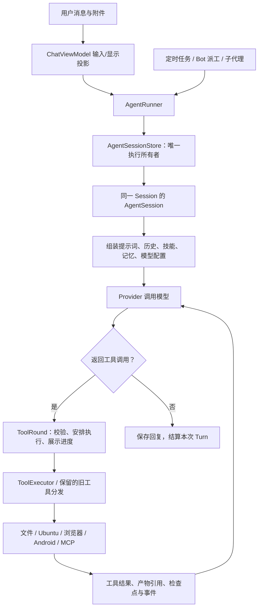

# 从 Agent 本身重新认识 Minis

核对日期：2026-10-11。源码基线：`3527ad8165f11c0f98d8a30f96098fc9280faa94` 与当前工作树。

细项补充：2026-10-12。全部功能详情集中在第 3 节；[Bot](#feature-bot) 与 [子代理](#feature-subagent) 在其中分别列明，开发方向仍见路线文档。

本文回答「这个 Agent 到底有什么、各部分怎样一起工作」，作为重整 Minis 的起点。不是报错清单，也不把界面标签、历史规划和已经实现的能力混为一谈。下文“已有”表示有当前实现与调用方；Android/OEM 条件能力不因此视为已完成真机验收。

## 1. 产品的真实形态

Minis 是运行在 Android 上的通用工具型 Agent，带本机 Ubuntu 工作环境和 Android 原生操作能力。模型通过 Provider 请求接入；本地 Kotlin 代码负责组织上下文、执行工具、保存会话和控制运行生命周期。

主执行循环现由 `AgentSession.runAgentLoop` 承载。AgentRunner 直接获取 AgentSessionStore 的唯一会话核心；ChatViewModelStore 只缓存页面投影。生命周期、Provider/模型状态、上下文预算/offload、压缩执行、队列、checkpoint 与 canonical 历史均归核心；UI 订阅流式投影与会话事件，页面销毁不会关闭执行。旧 Headless 路径已删除，M1 核心迁移与受控端到端验收已完成，见 [执行核心说明](../development/AGENT-CORE-EXECUTION.md)。

从用户任务看，它有六个组成部分：

1. **理解与决策**：可配置模型、提示词、思考强度、工具调用循环。
2. **行动**：文件、Shell、浏览器、Android 原生工具和外部 MCP 工具。
3. **上下文与知识**：会话历史、附件、技能、长期记忆、上下文压缩。
4. **任务组织**：当前回合、后台 Job、子代理、Bot 派工、Ralph、定时任务。
5. **工作与交付空间**：每会话工作区、共享目录、外部目录、文件预览与导出。
6. **用户交互与运行保障**：聊天、终端、语音、权限设置、前台服务、取消和恢复。

这六部分已经存在，但组织程度不一致。重整应围绕它们的关系，先厘清职责和状态，再决定保留、合并或补齐什么。

## 2. 一个请求实际怎样运行

它不是“模型给命令、终端直接跑”这样的一步工具。每次工具结果会重新进入模型上下文，模型可以继续观察、修改和验证。已有取消、超时、模型重试/回退、重复调用检测、上下文压缩、工具结果落盘和执行意图检查点。

重要边界：**完成一个 Turn、完成一个 Job、完成一个子代理、完成用户长期目标，是四件不同的事。** Bot 已有 Room 持久根任务，区分执行、审查、修订与交付；普通明确 Goal 已接入同一持久任务记录、请求/运行绑定、预算接续和实际证据验收；产物索引与协作交接仍需继续收敛。

源码入口：`agent/AgentRunner.kt`、`ui/chat/ChatViewModelStore.kt`、`agent/AgentLoop.kt`、`agent/ToolRound.kt`、`tools/runtime/ToolRegistry.kt`；远程读取投影由 `remote/ChatReadMethods.kt` 与 `SessionSnapshotReader.kt` 复用。

## 3. 已有能力全景

以下源码路径均相对于 `src/android/app/src/main/java/com/openminis/app/`。

| 组成 | 现在实际有什么 | 对用户的意义 | 主要实现 |
|---|---|---|---|
| 模型接入 | OpenAI Chat/Responses、Anthropic、Gemini 及兼容协议接入；API Key/OAuth、定制地址与请求配置 | 不绑定单一模型，可接入 DeepSeek 等兼容服务 | `provider/ProviderFactory.kt`、`provider/LLMProvider.kt`、`data/repository/ProviderRepository.kt` |
| 模型分工 | 当前有 **6 个**固定槽位：main、light、vision、voiceInput、voiceOutput、image；有顺序条目、思考配置和回退规则 | 推理、轻量任务、看图、语音和图像生成可分别选择模型 | `data/model/ProviderConfig.kt`、`provider/thinking/` |
| Agent 循环 | 多轮工具调用、批次结果配对、校验、可取消执行、失败分类、重复调用检测 | 一个请求可以完成一串观察与操作 | `agent/AgentLoop.kt`、`agent/ToolRound.kt`、`agent/ToolLoopDetector.kt` |
| 文件与代码 | 读、写、精确编辑、追加、复制、移动、删除、列表、路径搜索、grep、头尾读取、信息与图像读取 | 编辑代码、整理资料、读取构建输出、交付文件 | `tools/FileReadTool.kt`、`tools/FileWriteTool.kt`、`tools/FileEditTool.kt`、`tools/LinuxFileOpsTools.kt` |
| 本地执行 | Ubuntu 24.04 direct chroot；每会话持久 Bash、工作目录与环境变量；Python、pip、受控 apt；交互式终端 | 在手机上运行脚本、开发工具、下载和构建任务 | `runtime/ExecutionCoordinator.kt`、`runtime/ubuntu/`、`tools/runtime/ToolRegistry.kt` |
| 浏览器 | WebView 浏览器；导航、DOM 读取/定位、点击、输入、截图、JS、下载、Cookie、标签页、等待与视口配置 | 操作网站、采集网页、预览生成的 HTML | `browser/BrowserAction.kt`、`tools/AgentTools.kt`、`runtime/guest/BrowserUseOffloadHandler.kt` |
| Android 应用与界面 | 应用查询/启动、物理屏观察与操作；隔离虚拟屏的创建、启动应用、状态与关闭 | 操作手机应用，完成网页之外的任务 | `tools/android/AndroidAgentTools.kt`、`tools/android/AndroidUiController.kt`、`tools/android/vscreen/` |
| Android 开发调试 | 能力探测、日志游标与监听、诊断、APK 检查与部署；结构化本地 Root 系统命令 | 调试应用、检查安装包、读取设备证据 | `tools/android/AndroidCapabilityResolver.kt`、`tools/android/AndroidApkInspector.kt`、`tools/android/PrivilegedCommandRunner.kt` |
| 手机原生数据与动作 | 日历、联系人、位置、剪贴板、时间、Intent、Wi-Fi/蓝牙、媒体检索/控制、天气、拨号、系统设置、短信/通话记录、通知、闹钟/计时器、使用情况 | 处理个人助理任务；实际可用性取决于 Android 授权 | `MinisApp.kt` 工具注册、`tools/Android*Tools.kt`、`tools/NotificationTools.kt`、`runtime/guest/` |
| 设备特有资料 | ColorOS 记忆/笔记/录音、聊天应用图像缓存、剪贴板历史、健康汇总等工具 | 可利用特定设备已有数据；不是所有 Android 都支持 | `tools/ColorOs*Tools.kt`、`tools/ChatImageTools.kt`、`tools/PrivateDatabaseTools.kt`、`xposed/` |
| 技能 | 安装、启停、按会话配置、发现、读取 SKILL.md/资源、GitHub 检查与安装；提示词中披露技能 | 给模型补充做事方法和可用资源 | `data/repository/SkillRepository*.kt`、`tools/skills/SkillTools.kt` |
| 长期记忆 | 用户维护的 GLOBAL.md、按天记录、关键词和邻近文本检索、近期内容注入、注入预算与开关 | 跨会话保留偏好和事实 | `data/repository/MemoryRepository.kt`、`data/repository/MemoryInjectionBudget.kt` |
| 会话与上下文 | Room 聊天历史、附件、重试/编辑/重跑、会话分组、导出、历史工具；大结果 offload、上下文压缩/回退、模型窗口预算 | 长对话持续工作，并能找回历史内容 | `data/repository/ChatRepository*`、`tools/history/`、`agent/ContextOffloader.kt`、`agent/AgentContextCompactor.kt` |
| 提示词与人格 | SOUL.md、自定义系统提示词、可编辑模块、Bot/会话指令、技能/MCP/记忆片段、动态环境信息 | 用户可配置做事方式和表达方式 | `agent/SoulStore.kt`、`prompt/`、`agent/AgentPersistence.kt` |
| 角色卡与剧情上下文 | PNG/JSON 角色卡导入导出、会话绑定与快照、世界书、用户人设、按角色保存的剧情记忆 | 角色对话在会话中保持设定；与 Bot 工作身份、真实用户记忆分开 | `roleplay/`、`tools/CharacterMemoryTools.kt`、`ui/settings/CharactersScreen.kt` |
| 任务辅助 | Goal、Todo、Plan、用户提问、产物记录 | 记录当前目标和进度，向用户补充信息 | `tools/AgentStateStore.kt`、`tools/GoalTools.kt`、`tools/AskUserQuestionTool.kt` |
| 后台执行 | Shell Job，查询、输出游标/等待、停止、stdin 输入；与前台持久 Shell 分开 | 构建、服务器等工作不阻塞下一条前台命令 | `runtime/ShellJobs.kt`、`tools/JobRegistry.kt`、`tools/JobTools.kt` |
| [**子代理**](#feature-subagent) | 可配置角色名单、模型选择、独立子会话、运行/继续/查看/取消/引导与结果通知；总开关同时控制发布与执行 | 将一个任务的部分工作交给另一个模型上下文 | `agent/subagents/`、`tools/runtime/ToolRegistry.kt` |
| [**Bot 派工**](#feature-bot) | 持久 Bot 身份、独立任务会话、Room 任务/收件箱、排队领取、终态回执与去重 | 在持久角色之间分派任务 | `tools/BotDelegationCoordinator.kt`、`data/repository/Bot*Repository.kt` |
| Bot 根任务 | 持久目标、验收条件、阶段、暂停/取消、预算与修订计数；委派回执进入主任务审查阶段 | 子工作完成后由任务负责人继续验收；当前归属要求 Bot 身份 | `data/db/BotTaskEntity.kt`、`data/repository/BotTaskRepository.kt` |
| Ralph | 连续创建全新子会话，使用共享状态目录和有界交接报告推进同一目标 | 避免一段不断膨胀的上下文承担所有轮次 | `tools/RalphTool.kt` |
| 定时任务 | 一次、每天、工作日、自定义日期；新会话/追加会话/重跑消息；权限档、时间窗、运行记录 | 到指定时间再次执行 Agent 任务 | `scheduled/`、`runtime/guest/ScheduledTaskOffloadHandler.kt` |
| MCP 扩展与对外调用 | MCP client 连接外部服务器并注册工具；MCP server 提供受鉴权和调用方策略控制的本机工具 | 使用外部服务，也可让其他客户端调用部分手机能力 | `mcp/client/`、`mcp/server/`、`data/repository/MCPRepository.kt` |
| 自身配置 | `minis-config` 注册式读取/修改、审计与回退；模型、环境变量、提示词等配置入口 | Agent 能按已有授权调整自己的运行配置 | `config/`、`runtime/guest/ConfigOffloadHandler.kt` |
| 辅助模型与图像 | `minis-model-use` 列表/搜索/调用用户披露的模型；读图、视觉转述、图像结果落盘 | 让脚本使用模型处理资料，查看或生成图像 | `runtime/guest/ModelUseOffloadHandler*.kt`、`tools/ReadImageTool.kt` |
| 语音与交互外壳 | 系统/Provider ASR 与 TTS、聊天语音输入/朗读、桌宠轻量对话；工作树已接通连续语音工具任务 | 语音对话复用完整 Agent；桌宠仍为轻量对话 | `speech/`、`pet/PetChatEngine.kt`、`voicecall/` |
| 文件交付与管理 | 每会话目录、全局共享/技能/记忆、授权外部目录、minis:// 预览、系统文件 Provider、备份/恢复 | 把做出来的内容交付给用户并长期保存 | `runtime/ubuntu/UbuntuPaths.kt`、`data/MountedFoldersStore.kt`、`providers/MinisDocumentsProvider.kt`、`backup/` |
| HTML 小应用与快捷方式 | 生成 HTML 的预览、固定到桌面、路径/会话归属记录与深链打开 | 从 Agent 产物进入可重复打开的小工具 | `ui/preview/`、`webapp/ShortcutPinner.kt`、`data/repository/WebAppShortcutRepository.kt` |
| 产品入口与偏好 | 助手首页、会话列表/分组、Bot 团队、八类设置、用量统计、系统助理入口、分享/深链 | 进入任务、管理配置和查看已有工作 | `ui/navigation/`、`ui/home/`、`ui/settings/`、`deeplink/` |
| 运行保障 | 会话执行句柄、前台服务、取消/超时、执行意图和 run 检查点、会话事件回放 | 避免把“界面停止转圈”误认为任务成功；重启后能识别未结算调用 | `agent/AgentTurnHandle.kt`、`agent/RunCheckpoint*`、`tools/ToolCheckpointStore.kt`、`ui/chat/SessionEventHub.kt` |

工具数量随模式、记忆开关、图像模型、子代理身份、Bot 身份和已连接 MCP 改变，不能把源码中的全部工具名称相加当作某个会话实际拥有的工具数量。

### 细项阅读地图

下面按功能组织 35 项详情。每项说明入口、操作与配置、执行/保存关系及当前实现边界；细项编号是阅读分类，不是工具总数。

| 范围 | 细项 |
|---|---|
| 模型与执行 | 01–04：Provider、模型分工、Agent 循环、工具与模式 |
| 文件、Ubuntu 与网络工作 | 05–09：文件、Shell、Job、浏览器、搜索/URL |
| Android 与手机资料 | 10–16：应用/APK、物理屏、虚拟屏、诊断、特权能力、原生数据、OEM 数据 |
| 知识、上下文与任务 | 17–21：技能、记忆、历史、压缩、Goal/Plan/Todo/提问 |
| 身份与协作 | 22–25：Bot、子代理、Ralph、定时任务 |
| 扩展与人格 | 26–31：MCP、自身配置、提示词、角色卡、图像/辅助模型、语音/桌宠 |
| 产品与运行现场 | 32–35：存储/预览、备份、页面/入口/用量、生命周期与恢复证据 |

### 3.01 Provider 与模型服务接入

- **入口和配置**：服务商管理、新建/编辑服务商、模型条目；配置服务地址、协议、凭证、启用状态和请求选项。配置模型不等于只切换一个名称。
- **实际功能**：OpenAI Chat Completions、Responses、Anthropic、Gemini 及兼容端点；模型目录和自定义模型；API Key 与支持的 OAuth 接入。图像/语音走相应 Provider 能力。
- **调用关系**：ProviderRepository 提供配置，ProviderFactory 选择实现，主循环使用 LLMProvider；Bot、子代理和例程复用这些服务。
- **保存与边界**：配置与凭证有既有持久存储。服务商启用、条目存在、认证有效、接口支持四个条件分别影响可用性；兼容地址不能保证实现所有协议能力。
- **源码**：`provider/`、`data/repository/ProviderRepository.kt`、`data/model/ProviderConfig.kt`。

### 3.02 模型槽位、会话绑定与允许调用的模型

- **实际配置**：main、light、vision、voiceInput、voiceOutput、image 六槽；槽位有候选顺序，模型条目有能力与思考设置。会话可以绑定具体条目。
- **不同用途**：主对话用当前会话模型；light 用于适合的辅助工作；视觉、语音和图像使用对应能力。用户另有“Agent 可以使用的模型”名单，给子代理点名选模型和 `minis-model-use` 使用。
- **优先关系**：Bot 默认绑定参与创建会话，当前会话显式选择优先；子代理固定绑定优先于模型参数；例程新会话可写入自己的模型绑定。
- **保存与边界**：模型配置与会话绑定持久化。固定绑定失效与默认槽位回退不是同一件事；不能把“所有已添加模型”当作都已向 Agent 披露。
- **源码**：`data/model/ModelBinding.kt`、`agent/BotModelResolver.kt`、`agent/subagents/CallableModels.kt`、`ui/settings/AgentModelsScreen.kt`。

### 3.03 Agent 模型循环

- **输入**：用户文本、附件、排队补充、外部回执等；先解析会话配置并组装模型消息。
- **执行**：Provider 流式返回文本/思考/工具调用；ToolRound 校验与调度，工具结果与调用配对后再次请求模型；循环可跨多个观察和行动步骤。
- **已有控制**：取消、超时、模型错误处理、回退、重复调用检测、上下文预算/压缩、工具结果保存和运行记录。
- **状态归属**：主循环由 AgentSession 持有；前后台经 AgentRunner/输入适配消费同一核心，按本请求句柄等待与取消。UI 流状态、Turn 终态和用户目标完成分别存在。
- **源码**：`agent/AgentLoop.kt`、`agent/ToolRound.kt`、`agent/AgentRunner.kt`、`agent/AgentTurnHandle.kt`。

### 3.04 工具注册、别名、CLI 与 Agent 模式

- **实际结构**：ToolRegistry 持有 canonical 定义、handler 与 alias；AgentTools 根据当前模式、会话身份和配置生成模型 schema；ToolExecutor 校验 caller 并执行，大结果走预算/offload。
- **多个入口**：模型工具、Guest CLI、MCP、原生页面可以复用同一 handler；浏览器/记忆仍有旧分发路径。注册、可见、获准执行与后端可用分别判断。
- **模式**：standard 是 FULL；minimal 是持久 Shell 与文件三工具，Bot 会话仍保留协调工具；code/PTC 是 FULL 加脚本组合提示，目前无专用 TypeScript executor。
- **边界**：minimal 不等于新 OS 沙箱。模型看不见某 schema，也不直接证明它不能从已有 Shell/CLI 入口触达相关能力。取消/意图等仍有 ViewModel 外层职责待收敛。
- **源码**：`tools/AgentTools.kt`、`tools/runtime/ToolRegistry.kt`、`remote/AgentPresetRegistry.kt`、`runtime/guest/`。

### 3.05 文件读取、编辑、搜索与变更

- **读查**：文件正文、目录列表、路径搜索、grep、头/尾、文件信息；大文本返回可控片段或引用。读图另见 3.30。
- **写改**：新建/覆盖、精确编辑、追加、复制、移动、删除；修改队列协调文件变更。复制/移动涉及 Guest 和授权外部目录的路径解析。
- **执行关系**：WorkspaceFileClient / SecureFileAccess 面向当前 session 的实际文件空间；SAF 外部路径进入对应访问实现，不能拿宿主路径随意替代。
- **状态与边界**：最终文件在磁盘；工具输出与历史引用另行保存。只读挂载、会话文件写策略、路径穿越校验继续适用。当前工作树已有跨域流式复制修复，真实设备覆盖仍需单独确认。
- **源码**：`tools/FileReadTool.kt`、`FileWriteTool.kt`、`FileEditTool.kt`、`LinuxFileOpsTools.kt`、`runtime/files/`。

### 3.06 Ubuntu、持久 Shell、Python 与包管理

- **工作环境**：Android App 协调 Ubuntu 24.04 direct chroot；Root 建立受控 namespace/mount/chroot，Guest 最终以实际 App UID/GID、清空 groups/capabilities 执行。
- **前台 Shell**：同一 session 持久 Bash，命令顺序执行，`cd`/`export` 延续到后续命令，合并 stdout/stderr；有超时与取消。工具默认前台预算为 15 分钟。
- **辅助执行**：Python 与 pip 工具复用 Guest；`minis-apt` 由 App 构造 update/install/remove，运行必需包保护存在。交互式终端提供用户直接操作入口。
- **保存与边界**：工作文件与 App-owned 资料在磁盘，活跃进程和 Shell 环境不能视为重启可恢复。每 session 的 `/workspace` 映射自己的目录，Rootfs 属于可替换 runtime state。
- **源码**：`runtime/ExecutionCoordinator.kt`、`runtime/ubuntu/`、`runtime/guest/AptOffloadHandler.kt`、`tools/runtime/ToolRegistry.kt`。

### 3.07 后台 Shell Job

- **启动**：Shell 工具 `background=true` 创建独立进程/Job，立即返回 job_id；适合构建、服务和下载。它与前台 Shell 的 `cd`/`export` 状态分开。
- **操作**：`job_list`、`job_output`、`job_kill`、`job_input`；输出支持 offset/next_offset，等待超时返回 RUNNING 并保留 Job；stdin 可输入文本或 EOF。
- **状态**：RUNNING、COMPLETED、KILLED、FAILED；JobRegistry 进程级保存有界尾部输出，ShellJobs 管实际执行与清理。读输出成功不等于命令成功，需看 Job 终态/退出证据。
- **当前范围**：每 session 最多 6 个、全 App 最多 16 个活跃 Shell Job；默认 2 小时预算、最高 24 小时。注册表保存至多 100 项，输出尾部 200,000 字符。这些是当前事实，未在本次增加限制。
- **边界**：通用 Job 列表/输出/kill 使用进程级注册表；stdin 另校验 session 归属。不能套用子代理的父会话查询规则解释所有 Job；进程重启后不承诺恢复活跃 Job。
- **源码**：`runtime/ShellJobs.kt`、`tools/JobRegistry.kt`、`tools/JobTools.kt`。

### 3.08 内置浏览器

- **导航与页面**：navigate、back/forward/reload、page info、text/readable/backbone、DOM 元素查找、execute_js。
- **操作**：click、type/submit、hover、scroll、scroll_and_collect、screenshot；支持 selector/坐标和读图选项。
- **会话配置**：new/list/close tab、UA、viewport、get/set cookies；wait_for_selector 和 wait_for_dom_stable 用于等实际页面状态。
- **执行关系**：WebView 标签池和浏览器状态服务于 session；普通页面操作跟随当前标签，不能把一次 navigate 后的 JS 发往另一张空标签。CLI 经 minis-browser-use 复用能力。
- **保存与边界**：下载、截图及相关输出进入会话文件；标签实例/活跃页面是运行时状态。JS 页面操作不是 Ubuntu 任意程序；浏览器也不是手机系统应用 UI。
- **源码**：`browser/BrowserAction.kt`、`tools/AgentTools.kt`、`runtime/guest/BrowserUseOffloadHandler.kt`、`browser/`。

### 3.09 Web 搜索与 URL 读取

- **入口**：注册工具 `web_search`、`url_fetch`；与需要页面交互的 browser_use 同时存在。
- **用途**：查网页信息、读取 URL 内容，向模型返回检索/页面结果；需要登录或复杂交互时可转浏览器工作流。
- **执行关系**：Android 网络工具实现处理请求，结果进入统一工具上下文；Ubuntu 也可以通过网络和既有桥完成自己的下载。
- **边界**：搜索结果、网页内容与最终引用由实际返回决定；存在工具不保证网站可达或内容完整。HTTP/CONNECT 兼容代理只负责网络转发，不是工具/Root RPC。
- **源码**：`tools/Android*Tools.kt` 中相关 Web/URL handler、`MinisApp.kt` 注册、`network/`。

### 3.10 应用管理、APK 检查与部署

- **应用功能**：搜索启动器应用，把名称解析为包名；查询和启动应用，按已验证参数调用 Android 系统动作。
- **APK 工作流**：定位 artifactPath/searchRoot、inspect_apk、install、launch、install_and_launch；解析安装包元数据并安排安装路线。
- **执行关系**：AndroidAgentTools 调用 APK inspector、应用/部署实现与实际权限后端；APK 来源可来自会话、共享或授权外部目录。
- **边界**：解析成功、安装请求接受、系统安装完成、应用实际打开分别是证据。当前工作树取消了 APK 暂存的固定小文件上限，未凭此承诺所有大包在真机上都能安装。
- **源码**：`tools/android/AndroidAgentTools.kt`、`AndroidApkInspector.kt`、相关部署/应用控制实现。

### 3.11 物理屏观察与操作

- **观察**：observe、screenshot，节点可按交互性、文本、深度和数量过滤，返回 generation/ref 与界面指纹。
- **动作**：点击/长按、set_text、input_text、paste_text、IME enter、滚动、返回/主页/最近任务、通知/快捷设置、等待包名。
- **证据语义**：ref 绑定所观察界面，过时返回 STALE_UI_REF；截图坐标与物理像素有转换。结果区分接受且有效果、接受但没有效果证据、超时和拒绝等。
- **边界**：用户正在使用的屏幕是共享物理资源；实际后端和系统授权决定可执行动作。password 节点内容不进入 observation，截断扫描的 ref 不直接用于动作。
- **源码**：`tools/android/AndroidUiController.kt`、物理屏 backend、`DeviceScreenLease.kt`、AndroidAgentTools UI 定义。

### 3.12 虚拟屏

- **入口**：`android.vscreen.open/launch/status/close`；Android UI 工具带 displayId 执行该屏上的观察和操作。
- **运行条件**：Shizuku 协议 UserService 自检通过；服务身份只接受 shell UID 2000 或 Root UID 0。服务安装、版本和连接状态参与检查。
- **运行关系**：由现有屏幕租约与 session 归属管理，应用启动使用校验后的系统参数；动作返回新 observation，包含下一步能用的 generation/ref。
- **边界**：虚拟显示不是另一个完整 Android 系统，也不等于某 Bot 天然有一台独立手机。跨应用窗口、旋转/OEM 布局和进程存活需设备证据；当前工作树有跨应用观察修复但未完成真实 OEM 验收。
- **源码**：`tools/android/VirtualScreenUiBackend.kt`、`tools/android/vscreen/`、`offload/ShizukuManager.kt`。

### 3.13 Android 日志与诊断

- **日志**：mark_cursor、snapshot、watch、read、stop、clear；支持包、buffer、priority 等过滤，先标游标再操作可关联因果。
- **诊断**：process、memory、crash、anr、stack、all；按目标包返回相应证据。
- **运行关系**：监听等长动作使用现有后台记录；结果受输出预算控制，用户可结合 UI 操作与日志检查应用行为。
- **边界**：某些证据依赖特权/系统可见性；空结果与后端不可用必须分别解释。诊断工具不能保证每个 OEM 都提供所有信息。
- **源码**：`tools/android/AndroidAgentTools.kt` 中 logs/diagnose、Android 日志与诊断实现。

### 3.14 能力探测、Root 与 Shizuku

- **探测入口**：get 是被动快照；active_root_probe 才可能请求 su 授权；probe_native_chroot 检查 mount/namespace/chroot 条件。
- **执行身份**：Guest 是 App UID；DirectRootRunner 执行 App 构造的基础设施；`root.shell` 使用可信系统工具 basename + argv，保持 local-only 与受控超时/输出/清理。
- **Shizuku 用途**：服务状态、特权兼容与虚拟屏 UserService；Root 认证与 Shizuku READY 分别存在，不能互相替代所有动作。
- **后端事实**：Root 诊断实际走 DirectRootRunner，能力层按 Root/App 回退报告；Shizuku READY 单独报告，不作为这些诊断动作已可执行的证明。
- **源码**：`tools/android/AndroidCapabilityResolver.kt`、`PrivilegedCommandRunner.kt`、`tools/runtime/RootShellHandler.kt`、`offload/ShizukuBackend.kt`。

### 3.15 手机原生资料与系统动作

这些工具已注册，有实际 Android/桥接实现；系统授权和设备条件独立决定是否可用。

| 功能 | 已有动作与输入 | 实际条件与归属 |
|---|---|---|
| 日历 | 查询、创建、更新、删除事件 | Calendar Provider、日历授权；实际记录在系统日历 |
| 联系人 | 搜索、管理联系人 | Contacts Provider 与对应读写授权 |
| 位置/时间/天气 | 当前位置、当前时间、天气查询 | 定位授权/服务、时区、网络或天气服务 |
| 剪贴板 | 当前剪贴板读取/设置 | Android 前台/平台条件；历史检索另走 OEM/私有资料路径 |
| Intent/拨号/设置 | 发送 Intent、发起拨号、查询/修改可支持设置 | 动作种类、系统处理器、设置授权/特权条件 |
| Wi-Fi/蓝牙 | 状态、扫描、配对设备；部分状态切换 | 查询授权与平台限制；直接切换使用已注册特权路线 |
| 图库/音频/文件 | 图像、音频/录音、MediaStore 文件搜索与信息 | 媒体授权或可读 content URI；返回资源供后续读取 |
| 媒体控制 | 媒体信息、播放控制 | 活跃媒体会话与其可支持动作 |
| 短信/通话记录 | 短信、验证码提取、通话记录读取 | 对应系统授权和数据可见性；验证码提取不同于发送短信 |
| 通知 | 当前通知、通知历史搜索 | Notification Access 和 listener 已连接；历史有界，敏感正文不直接存聊天 |
| 闹钟/计时器 | 设置、打开时钟界面、列出现有闹钟/计时器 | 创建走系统时钟；列表读支持的时钟数据库快照，编辑/取消不据此假定可执行 |
| 应用使用情况 | 使用时间/记录查询 | Usage Access；区别于 Minis 模型 token 用量统计 |

源码入口：`MinisApp.kt` 注册、`tools/Android*Tools.kt`、`NotificationTools.kt`、`AlarmTools.kt`、`runtime/guest/` 中对应系统 handler。

### 3.16 OEM 与私有应用资料

| 资料能力 | 当前读取路线 | 不能扩大的解释 |
|---|---|---|
| ColorOS 记忆/地点/订单 | 模块在目标进程提供对应资料 | 不代表通用 Android 都支持 |
| ColorOS 笔记/录音/录音摘要 | 目标应用发布的 Provider | 拒绝访问应报条件缺失，不是假装没有资料 |
| 微信/QQ 聊天图片 | 受控特权缓存扫描，返回路径/种类/时间/大小 | 不等于已解析完整聊天历史 |
| 下载记录 | 下载 Provider 可读视图 | 不等于任何下载目录都能任意读写 |
| 剪贴板历史/健康汇总 | 支持的私有数据库快照 | 数据库版本、授权和实际后端决定可用性 |

资料来自用户手机，工具结果与敏感持久化策略分别处理。LSPosed/系统增强配置是条件入口，不能当作所有原生功能必需，也不能当作虚拟屏的替代后端。

源码：`ColorOsMemoryTools.kt`、`ColorOsPersonalDataTools.kt`、`ChatImageTools.kt`、`DownloadsTools.kt`、`PrivateDatabaseTools.kt`、`xposed/`。

### 3.17 技能

- **用户入口**：技能管理、详情/文件阅读、启停、会话选择、技能浏览与安装。
- **模型操作**：list、read SKILL.md、read resource、inspect GitHub、install GitHub，共五类 handler；支持发现说明、按需读完整方法和资源。
- **保存关系**：SkillRepository 与 App-owned `/var/minis/skills` 管内容、启用/使用等元数据；提示词披露相关技能。
- **边界**：读资源和安装是不同操作；安装逻辑走已有仓库锁与路径校验。技能中的脚本要由已有执行工具运行，文档不能直接成为新权限。
- **源码**：`data/repository/SkillRepository*.kt`、`tools/skills/SkillTools.kt`、`ui/settings/SkillsManagementScreen.kt`。

### 3.18 长期记忆

- **结构**：GLOBAL.md 是用户维护的背景记忆；YYYY-MM-DD.md 是按日记录，Agent 写入带时间的条目。
- **操作与配置**：memory_write、memory_get；scope daily/all、关键词与邻域匹配；全局/会话开关、记忆管理与文件编辑。
- **模型关系**：GLOBAL/近期记忆片段按注入预算进入上下文，完整内容可检索。当前是文件与关键词机制，没有已接入的向量知识库。
- **保存与边界**：跨 session 共享全局记忆；当前没有每 Bot 独立工作记忆。记忆不能替代最新消息与当前资料；角色剧情记忆是另一种归属。
- **源码**：`data/repository/MemoryRepository.kt`、`MemoryInjectionBudget.kt`、记忆设置页与主循环注入。

### 3.19 会话、历史与重试/重跑

- **用户功能**：新建会话、列表/分组、继续历史、附件、编辑消息、重试、从工具块重跑、导出和删除。
- **模型历史工具**：conversation.history 从可信当前 session 读取，支持有界分页/搜索及后续游标；不让模型指定另一个 session。
- **保存关系**：Room 保存 session、message、压缩标记等；文件和媒体有磁盘归属。Bot 可以有多个历史会话，委派会话与直聊会话分开。
- **边界**：历史记录是已经保存的内容，敏感工具正文和部分临时图像未直接写入；重跑可能执行新动作，不能当作纯显示操作。
- **源码**：`data/repository/ChatRepository*`、`tools/history/ConversationHistoryTool.kt`、`agent/AgentEdit.kt` 等。

### 3.20 上下文预算、压缩与 offload

- **预算**：模型窗口、历史、提示词/技能/记忆、工具 schema 与输出共同占用请求预算，不能只按聊天文字长度估计。
- **offload**：大工具结果存会话文件并返回片段/引用，避免所有内容一次进入模型；后续可按路径读取。
- **压缩**：自动/手动 compact、边界标记、summary 校验、失败分类与回退；切分需要保持工具交换完整，最新用户消息保护存在。
- **保存与边界**：Room 压缩标记与磁盘 offload 可留下，活跃请求状态另有生命周期。历史引用的 offload 不应统一当垃圾；压缩成功也需检查是否保留当前约束和现场。
- **源码**：`agent/AgentContextCompactor.kt`、`agent/AgentCompaction.kt`、`ContextOffloader.kt`、`data/ContextOffload.kt`。

### 3.21 Goal、Plan、Todo、Deliverable 与提问

- **Goal**：读/创建/更新目标，Room v25 复用根任务保存 id、revision、状态、验收条件、预算、进度与证据，普通 owner 可以没有 Bot；ACTIVE 目标在同一循环消费持久预算接续，完成必须后端核验。见 [M2 任务执行](../development/AGENT-TASK-EXECUTION.md)。
- **Plan/Todo**：与明确 Goal 关联的任务计划保存于同一 Room 记录；无 Goal 的软计划与临时 Todo 保持 AgentStateStore 进程状态。
- **Deliverable**：记录本回合 write/edit 的路径与时间；目前不是完整持久交付索引，不自动证明产物正确。
- **提问**：ask_user_question 可给选项、自定义回答、多选和等待预算，工具等待用户答案并返回结构化结果；问题不是自动审批所有执行的统一入口。
- **关系**：这组辅助状态尚未等价于 BotTask 的持久主任务。迁移应复用现有任务基础，而不是将这几个 map 复制成第二套框架。
- **源码**：`tools/AgentStateStore.kt`、`GoalTools.kt`、`AskUserQuestionTool.kt`、`tools/runtime/ToolRegistry.kt`。

### 3.22 Bot：持久工作身份、任务与派工

用户于 2026-10-12 补充：最初参考 Grok Bot，希望将“持久协作成员 + 可操作的计算环境”落在本机手机上。这是产品目标；下列为当前 Minis 实现。

- **成员配置**：名字、systemPrompt 工作职责、默认 modelBinding、enabled；Room 保存身份。用户在 Bot 页面创建/编辑/启停/删除，当前上限 12；模型没有 create_bot 工具。
- **直接对话**：打开最近直聊或开启新话题；新会话绑定 bot_id 与解析出的模型。Bot 资料会注入身份/职责，用户在当前会话选的模型可以覆盖默认。
- **语音入口**：2026-10-12 工作树已在成员详情接入语音对话，复用直聊与 Bot 身份。当前会话忙时沿原 STEER 队列补充；挂断保留任务。默认接待 Bot、系统唤醒恢复对象与持久用户收件队列尚未实现，见 [融合方向](../development/BOT-VOICE-INTEGRATION.md)。
- **派工工具**：list_bots 查询可委派名单；delegate_bot(target_bot_id,prompt) 排队；check_delegation(task_id) 查询当前 Bot 来源会话的委派。普通无 Bot 身份会话不能使用这组派工权限。
- **执行链**：来源 Turn 成功结算并持久写入 barrier → 事务领取 → 目标 Bot 独立任务 session/workspace → AgentRunner 执行 → 持久回执/结果卡/收件箱 → 来源 Bot 复盘。委派目标不读取其直聊历史，资料须显式交接。
- **两层任务**：BotTask 是目标/验收条件/阶段/预算/停止代次；BotDelegation 是某项成员工作，QUEUED、WAITING_TARGET、RUNNING 及明确终态；BotInboxEvent 是持久投递与唤醒记录。三个对象不能互相替代。
- **调度与界面**：每 Bot 同时一个 in-flight Turn；直聊、定时、委派共用锁。团队/成员详情显示近期会话、工作和例程，进度页看根任务与委派、打开关联会话、暂停/取消。
- **当前自动复盘**：同一根任务相关成员结束后按持久 inbox 分组唤醒负责人。现有预算为自动复盘 3 次、修订 2 轮、根任务累计派工 8 条；每来源 Turn 4 条，委派深度 1。目标忙有重试，停止代次抵抗迟到回执。
- **实际完成判断**：负责人回合 Completed 不再直接完成根任务；GoalTools 核验当前任务的实际文件/持久回执，无证据回复进入 NEEDS_USER，新派工继续等待结果。
- **保存与恢复**：成员/根任务/委派/inbox 在 Room。进程死亡的 RUNNING 委派保留未知结果语义，不自动重放；待派发任务仅在明确初始化恢复条件下扫描。备份包含成员定义，不包含任务/委派/inbox 流水。
- **尚未接通的产品关系**：Bot 专属工作记忆、Bot 专属技能/资料配置、显式共享工程与成果、多成员群聊/转交语义未形成完整产品。目前复用全局 Memory、技能和 runtime；每 Bot 没有独立 Ubuntu/Root runtime。
- **源码**：[BotRepository.kt](../../src/android/app/src/main/java/com/openminis/app/data/repository/BotRepository.kt)、[BotDelegationCoordinator.kt](../../src/android/app/src/main/java/com/openminis/app/tools/BotDelegationCoordinator.kt)、[BotWakeDispatcher.kt](../../src/android/app/src/main/java/com/openminis/app/tools/BotWakeDispatcher.kt)、`data/db/Bot*`、`ui/bots/BotsScreen.kt`；边界见 [Bot 合同](../contracts/08-BOT-COORDINATION.md)。

### 3.23 子代理：角色配置与一次子任务执行

- **用户入口**：子代理设置；总开关、角色名单、名称/description/instructions、固定模型或 Auto、thinking override、排序。内置 General Sub Agent 保留，名单最多 10（含内置），配置进 SharedPreferences，备份支持自定义定义。
- **新版工具**：同一个 subagent 支持 delegate/status/steer/cancel/resume；delegate 输入完整 task、可选 context、agent、model_choice 或 model、max_minutes、wait、progress_report。
- **模型选择**：固定角色绑定优先；显式 model 必须在用户披露名单；Auto 可 same_as_me/default_model/sub_model，对应父当前模型/main/light。light 不可用时现有实现可回 main；固定绑定失效报错，不能统一宣称所有路径都无回退。
- **上下文与文件**：创建 source=sub_agent 的独立子会话，复用 AgentRunner、工具和自己的 workspace。父历史不自动传入；资料须写进任务或显式共享文件。schema 中“无记忆”的文案不能解释为已实现独立记忆隔离，实际新会话仍使用普通会话的记忆配置。
- **并发与排队**：新版全局 3 个同时运行、10 个排队；满并发返回 queued，不必重复派发。子会话不再提供 subagent schema，handler 也拒绝再委派。
- **过程控制**：wait=false 立即给 job_id，结束后以新消息回父会话；wait=true 同步等待，父等待取消会停止子工作。steer 向正在运行的子会话排入纠正，不打断当前工具；结束太快可能来不及读取。
- **进度与时间**：默认只最终结果；frequent 约 15 秒、有变化才报告，moderate 约一分钟。新版 max_minutes 默认 10、最高 60；超时先停止并尝试有界收尾，返回 partial result/TIMEOUT。
- **状态与恢复**：queued/running/completed/cancelled/failed/timeout/interrupted；最近 30 项镜像到 prefs，简报最多 20,000 字符、持久结果最多 8,000，实时最终结果另有 60,000 字符预算。重启时活跃项变 interrupted，resume 显式重新进入排队/运行，利用旧子会话和文件核实后继续。
- **通知机制**：运行结算与投递解耦，父会话同一 delivery lock 排序；AppSubAgentPort 等父回合 settle 后投递，有忙时重试。它不等于 Bot 的持久 inbox，回执送达失败不能据此承诺一定自动补回。
- **旧入口收敛**：旧同步 SubagentTool 已删除。关闭总开关时模型与本地目录不发布委派，旧名称调用也拒绝；canonical schema 与现役角色/队列的 task/action 一致。旧 child source=subagent 和现役 sub_agent 均识别为子会话。旧 SubagentLimits 深度不控制现役子代理，时限仍被 Ralph 单轮使用，其设置/诊断需按实际调用方整理。
- **源码**：[SubAgentToolSchema.kt](../../src/android/app/src/main/java/com/openminis/app/agent/subagents/SubAgentToolSchema.kt)、[SubAgentRuntime.kt](../../src/android/app/src/main/java/com/openminis/app/agent/subagents/SubAgentRuntime.kt)、[AppSubAgentPort.kt](../../src/android/app/src/main/java/com/openminis/app/agent/subagents/AppSubAgentPort.kt)、`SubAgentJobRegistry.kt`、`SubAgentStore.kt`、`tools/runtime/ToolRegistry.kt`。

### 3.24 Ralph 连续轮换上下文

- **入口**：ralph(objective,maxRounds)；一个固定目标，默认 3 轮、最高 6，每轮新建 session，而非接着堆同一段上下文。
- **交接**：跨轮资料放 `/var/minis/shared/ralph/<runId>`；仅前一轮有界 handoff 报告带入下一轮。报告状态 complete/blocked/continue，携带摘要、证据、下一步或阻塞原因。
- **执行**：每轮经 AgentRunner 同步等待，单轮使用 SubagentLimits 的时间配置；达到 complete、blocked 或轮次上限后返回。无效报告使流程失败，当前全局 activeRuns 阻止活跃 Ralph 期间再次启动。
- **保存与边界**：共享文件与子会话会留下，外层循环/计数是进程执行状态，不等于持久任务调度器。它没有 Bot 成员身份，也不使用新版子代理队列的 job_id 生命周期。
- **源码**：`tools/RalphTool.kt`、`tools/SubagentLimits.kt`。

### 3.25 定时任务与例程

- **配置**：标签、提示词、时间、ONCE/DAILY/WEEKDAYS/CUSTOM、选定星期、起止日期、启用状态、模型绑定、botId、权限档。
- **目标**：NewSession 新会话、AppendToSession 追加既有会话、RerunMessage 从既有消息重跑。Bot 例程沿对应成员身份执行。
- **执行链**：AlarmManager 安排下一次 → Receiver/管理器 → ScheduledAgentRunner → 同一 AgentRunner；记录触发时间、结果预览、ok 和会话，用户能打开运行历史。
- **授权与存储**：现有 SharedPreferences JSON 保存；新例程 READ_ONLY，FULL 创建/修改需要原生编辑器确认。旧 JSON 缺档位保留 FULL，畸形值降为只读；恢复 FULL 例程处于关闭状态。
- **边界**：只读不是无网络沙箱，写入范围与 shell allowlist 有具体规则；定时触发受 Android 后台/闹钟条件影响。一个定时 Run 完成不等于所有长期目标完成。
- **源码**：`scheduled/ScheduledTask.kt`、`ScheduledTaskManager.kt`、`ScheduledAgentRunner.kt`、`runtime/guest/ScheduledTaskOffloadHandler.kt`。

### 3.26 MCP 输入扩展与输出手机能力

- **Client**：用户管理外部 MCP 服务器、连接及工具；仓库加载定义并进入现有工具注册/会话披露路径，按会话启用。
- **Server**：本机监听 loopback 的受鉴权服务；令牌、工具 scopes、caller 权限和确认队列控制对外能力。没有 token 不能当作无鉴权公开服务。
- **关系**：Client 是 Minis 调外部，Server 是外部调 Minis；都不能复制本地全部权限。root.shell 保持 local-only，不在 MCP 暴露。
- **保存与边界**：连接配置可持久/备份；系统授权与审批不由备份授予。当前仓库没有一个可据此宣称完整交付的 Web 远程前端；DebugServer 也不能当生产远程协议。
- **源码**：`mcp/client/`、`mcp/server/`、`data/repository/MCPRepository.kt`、`ui/settings/MCP*`。

### 3.27 Agent 修改自身配置

- **入口**：Guest `minis-config` 读主题/字段说明、读取/修改注册字段与集合、查看审计、回退审计项。
- **可配置面**：服务商/模型/槽位、环境变量、思考规则、已注册的 App 偏好与提示词等；由 ConfigRegistry/ConfigSchema 决定实际可见字段。
- **执行关系**：ConfigBridge 校验、权限/确认、应用变更和审计；Autonomy ASK/SMART/FULL 针对自身配置决策，不是万能 Root 权限。
- **保存与边界**：落到各原有配置真源，不创建平行 prefs。审计回退也遵守当前边界；读配置无需因此输出原始密钥；不是任意修改 Android App 私有数据库。
- **源码**：`config/`、`config/audit/`、`config/confirm/`、`runtime/guest/ConfigOffloadHandler.kt`。

### 3.28 系统提示词、SOUL 与环境上下文

- **用户配置**：SOUL.md、自定义 system prompt、内置提示词模块与启用状态；会话/Bot 职责叠加到有效请求。
- **动态内容**：工作路径、运行环境、可用技能、记忆、MCP/子代理模型名单等，在组装模型请求时加入。
- **作用**：控制表达与做事方法，提供真实可用能力说明。模型收到的最终上下文由会话配置和运行条件决定。
- **保存与边界**：自定义配置持久；当前模型请求中的快照是一次执行的上下文。提示词能影响选择，不能替代 handler 的身份、权限和生命周期校验。
- **源码**：`agent/SoulStore.kt`、`prompt/`、`agent/AgentPersistence.kt`、`ChatViewModelInput.kt`。

### 3.29 角色卡、世界书与剧情记忆

- **入口与操作**：角色列表/详情、创建/编辑、PNG/JSON 导入导出、绑定会话；卡片包括描述、性格、场景、示例对话与角色指令，另有用户人设与世界书。
- **上下文**：当前 live card 优先，卡被删除时使用会话保存的 card snapshot；世界书根据角色对话匹配并按位置/深度注入，工具流量不当作剧情对白。
- **剧情记忆**：按角色保存，read/update 工具绑定当前会话角色，用 revision 阻止基于旧版本覆盖；注入有预算。
- **保存与边界**：角色元数据进 Room，头像/卡相关资料及记忆有磁盘归属，备份支持。角色的虚构身份不改变真实执行权限；不是 Bot 身份，也不写成真实用户的全局记忆。
- **源码**：`roleplay/`、`tools/CharacterMemoryTools.kt`、`ui/settings/CharactersScreen.kt`、主循环角色注入。

### 3.30 读图、辅助模型调用与图像生成

- **读图**：read_image 支持 Guest/minis/file 路径及支持的系统图库 URI，返回尺寸/大小；当前模型有视觉时直接给图，没有时用已配置 Vision 模型转述，prompt 可限定问题。
- **辅助模型 CLI**：minis-model-use list/search/run，用户披露的模型名单决定可调用条目；可用文件输入/输出、系统提示和生成参数调用模型。
- **图像路线**：Image 槽位、支持的图像 endpoint 模式、Provider 参数与结果落盘；图像参数/接口能力实际由服务商决定。默认选 Image 槽位也仍受允许名单校验。
- **边界**：辅助 run 与主 Agent 工具循环不同；模型 API 调用不因此成为新的 Root 执行器。读图工具不接受任意远程 URL 或任意 content URI；结果是否可预览由真实文件决定。
- **源码**：`tools/ReadImageTool.kt`、`runtime/guest/ModelUseOffloadHandler*.kt`、`offload/ModelUseManager.kt`、Provider 图像实现。

### 3.31 语音、朗读与桌宠

- **语音输入**：系统或 Provider ASR，语言/voiceInput 配置，识别结果进入聊天输入流程。
- **输出**：系统/Provider TTS、voiceOutput、音色列表/选择、朗读启停、静音与语速等；Agent 也有对应语音 CLI/工具。
- **桌宠**：独立轻量对话与交互入口；PetChatEngine 直接请求 Provider，当前不等于完整工具 Agent Turn。
- **通话状态**：2026-10-12 工作树已将 VoiceConversationHost / CallController / MinisCallRuntimeAdapter 接到当前 AgentSession 的完整工具回合。聊天声波按钮、Bot 详情、系统助理与语音快捷方式共用入口，连续识别→执行→朗读→聆听；支持静音、补充要求、明确打断及挂断保留任务。当前为轮流对话，原生音频全双工、说话打断与真实 OEM/锁屏行为仍待独立验收。
- **源码**：`speech/`、`runtime/guest/SpeechOffloadHandler.kt`、`SpeakOffloadHandler.kt`、`pet/PetChatEngine.kt`、`voicecall/`。

### 3.32 工作空间、文件页、预览与 HTML 小应用

- **空间**：每会话 workspace、attachments、offloads、browser、Android media；全局 shared/skills/memory；SAF 挂载与 Android cache；Rootfs 单独归属。
- **用户动作**：浏览/预览文件、打开会话文件、共享/导出、通过 DocumentsProvider 暴露支持的资料、管理外部目录授权与只读设置。
- **HTML 产物**：WebPreview 展示本地 HTML，支持固定到桌面；ShortcutRepository 记录 session/shared/mount 路径归属，通过 minis:// 深链再次打开。
- **保存与边界**：文件、索引和桌面固定项是不同状态；删源文件会影响快捷方式。FilesHub 当前统计不是完整磁盘账本，offload 引用与成果需要区分，外部目录的 SAF 授权不保证普通 Guest POSIX 直接访问。
- **源码**：`runtime/ubuntu/UbuntuPaths.kt`、`data/MountedFoldersStore.kt`、`ui/settings/FilesHubScreen.kt`、`providers/MinisDocumentsProvider.kt`、`ui/preview/`、`webapp/`。

### 3.33 备份与恢复

- **交付形式**：`.minisbak` ZIP，可选加密；本机 Download/Minis Backups 与已有 SMB/WebDAV/SFTP/S3/FTP 目的地入口。
- **包含**：聊天与工作区、角色卡/头像/剧情记忆、Bot 定义、shared、skills、memory、MCP 配置、Provider/模型/子代理定义、白名单 App 设置/提示词/定时任务、环境变量，具体类别可选择。
- **恢复规则**：按 id/updatedAt 合并，保留本机独有消息；事务边界与停止恢复存在；配置/角色/成员/任务校验；FULL 例程恢复关闭。
- **重要归属**：Bot 身份能备份，Bot 任务/委派/inbox 流水未包含；子代理定义能备份，不等于活跃任务恢复。外部 SAF 授权、系统权限、runtime 安装状态、备份服务器凭证不迁移。
- **源码与说明**：`backup/`、`ui/settings/backup/`、[备份合同说明](../development/BACKUP.md)。

### 3.34 页面、快捷入口、设置与用量

- **入口**：会话列表/分组、聊天、Bot 团队、可选助手首页、终端；分享资料、minis:// 深链和系统助理角色进入已有产品流程。
- **助手首页**：当前四种快操作为分析屏幕、打开微信、浏览网页、内存压力，用户选择显示项；它们是已有工作入口，不是四种新 Agent。
- **设置**：模型、Agent、聊天、外观、文件、runtime、系统、数据八类；包含技能/记忆/子代理、权限、模型用量、日志、备份等子页。
- **用量**：从已保存 usage 记录按 Provider/模型统计输入、输出、缓存创建/读取、日期和会话归属，区分测量/估算/未知归属；不同于手机应用使用情况工具，也不是已建立的 Task 成功率评测系统。
- **源码**：`ui/navigation/AppNavigationRoutes.kt`、`AppNavigation.kt`、`ui/home/AssistantHomeModel.kt`、`ui/settings/SettingsCategoryScreen.kt`、`UsageStatsScreen.kt`、`deeplink/`。

### 3.35 运行生命周期、权限与恢复证据

- **运行所有权**：会话实例、AgentTurnHandle、前台服务、执行清理控制实际 active Turn；页面停止转圈不等于 Task 成功，数据库里有排队项不保证系统已运行。
- **权限维度**：本地/MCP caller、会话文件写 preset、例程档、原生 Android 授权、Root/Shizuku、配置自主程度各自校验；已有授权应按实际作用域复用。
- **工具意图**：ToolCheckpointStore 在执行前记录，在保存结算结果后移除；重启遗留 pending 表达 outcome unknown，不能单凭它重放外部写入。
- **运行与事件**：RunCheckpointStore 保存有界运行资料；SessionEventHub 有实时窗口、异步 Room、watermark/replay/reset 语义，不是无限完整任务日志。
- **边界**：活跃 Shell、浏览器对象、协程不跨进程保存。当前已有恢复检测，但普通 Goal 与 Bot 已接入实际证据验收；非文件副作用恢复、持久产物索引和协作交接仍有缺口。
- **源码**：`agent/AgentTurnHandle.kt`、`RunCheckpointStore.kt`、`tools/ToolCheckpointStore.kt`、`ui/chat/SessionEventHub.kt`、`tools/runtime/ToolPermissionManager.kt`、`SessionPermissionStore.kt`、`offload/OffloadPermissionManager.kt`。

### 任务组织功能之间的关系

| 对象 | 身份/角色 | 实际执行内容 | 跨回合与重启依据 | 典型用途 |
|---|---|---|---|---|
| 普通 Agent session | 当前会话配置 | 模型工具循环 | Room 历史/文件/运行检查点及明确 Goal/任务计划/验收证据；按保存预算接续 | 用户直接交办 |
| Bot | 持久成员与职责 | 直聊、例程、委派工作、负责人复盘 | Room 身份/根任务/委派/inbox | 持续负责一种工作 |
| 新版子代理 | 可复用角色定义 + 一次 job | 独立子上下文与工具循环 | 有界 prefs 摘要 + 子会话；显式 resume | 交办具体子问题 |
| Shell Job | 无 AI 成员身份 | 一条后台命令/进程 | 进程级注册表，活跃状态不保证恢复 | 构建、下载、服务 |
| Ralph | 固定目标的轮换流程 | 多个新上下文串行执行 | shared 状态文件；外层循环当前非持久调度 | 长探索与有界交接 |
| 定时任务 | 调度配置，可绑定 Bot | 到时启动/追加/重跑 Agent | JSON + AlarmManager + 运行记录 | 重复例程 |

它们共享 Provider、工具与 runtime，有各自的状态所有权。模型任务的文件不会因共享同一个 Ubuntu 就自动出现在其它 session workspace 中。

## 4. 工具、技能、CLI 与模式究竟是什么关系

### 同一种能力可能有几种入口

- 模型工具调用：`AgentTools.makeAgentTools()` 生成这轮模型能看见的 schema。
- 统一工具实现：大部分进入 `ToolRegistry` 和 `ToolExecutor`；浏览器和记忆仍保留旧分发路径。
- Guest CLI：`android-*`、`minis-*` wrapper 通过 `GuestCommandBridge` 到既有 Android handler。
- 用户命令：`/model`、`/permission`、`/goal`、`/plan`、`/compact`、`/clear`、`/memory`、`/thinking`、`/feedback`、`/export`。
- App 页面：设置、文件、终端、技能、模型等入口。
- MCP/RPC 适配：调用或观察相应实现；DebugServer 仅 Debug 构建，不是生产远程服务。

这些入口不能算成几套独立 Agent 能力。是否正常工作取决于它们最终是否复用同一状态与执行语义。

### Skill 的实际含义

Skill 是说明文档、资源与可能的脚本。Agent 读取其规则，再用已有文件、Shell、浏览器等工具做事。它没有因安装 SKILL.md 就凭空获得一个新执行后端；原生新能力来自实际 handler 或 MCP 服务。

### 当前三种模式

| 模式 | 当前实现事实 |
|---|---|
| standard | 完整工具集，结合会话和各能力配置生成实际 schema |
| minimal | 提供持久 Shell 和文件读/写/编辑四个核心工具；Bot 身份还保留 Bot 协调工具 |
| code / PTC | 与 standard 相同工具集，追加优先组合脚本的提示词；**尚无专用 TypeScript Code Mode SDK executor** |

minimal 改的是模型看到的工具列表，不是另一个 Ubuntu，也不等于 Shell 所能访问的原生桥能力全部消失。

## 5. 哪些状态真的能留下来

| 状态 | 当前存放方式 | 不能据此承诺什么 |
|---|---|---|
| 消息与会话 | Room | 会话仍在不代表执行中的进程仍在 |
| 工作文件、附件、offload、共享产物 | App-owned 磁盘目录 | 文件仍在不代表产物已验证或已交付 |
| 用户模型、技能、权限、定时任务配置 | 各现有持久仓库 | 配置存在不代表当前模型/系统授权可用 |
| Bot 根任务、委派任务与收件箱 | Room；根任务已区分执行、审查、修订、交付及暂停/终态 | v25 允许普通 session owner 并保存证据；Goal 接续与验收使用同一核心，未知副作用先核验 |
| 子代理 Job 摘要 | SharedPreferences，内容有界 | 不等于活跃子进程可跨进程重启接续 |
| 会话事件 | 有界内存窗口 + 异步 Room 保存 | 不等于永不裁剪的完整任务日志 |
| 工具执行意图、run 检查点 | App 私有文件 | 能识别未知结果，不保证任意操作恰好执行一次 |
| 明确 Goal / 任务计划 | **Room 根任务**；ID、约束、状态、预算与计划可恢复 | 普通 ACTIVE 目标按预算接续，完成引用实际文件或当前任务持久工具回执 |
| 临时 Todo、无 Goal 的软计划、Deliverable 列表 | **进程内 map** | 不等于长期进度和持久产物索引 |
| 活跃 Shell/通用 Job | 进程内执行状态和实际进程 | Android 杀进程后无损恢复 |

Goal 的 `maxGoalRounds` 已由主循环消费，回复结束与目标完成分别结算；暂停、chat-only、待决策和未知动作不会自动接续。Ralph 与定时器仍承担各自调度用途，不应仅改名成 Goal。

M2 已复用 `BotTaskRepository` 根任务，`BotTaskEntity.ownerBotId` 可空并用唯一 session Goal 关联表示普通归属；没有创建虚假 Bot 或平行 Task 数据库。Goal 接续与实际验收已接入；非文件未知动作核验继续补齐，产物索引随 M4 接入。

## 6. 从文件页看 Agent 的工作空间

截图显示的目录，本质上对应 Agent 的不同数据：

| 数据 | 路径/归属 | 应怎样理解 |
|---|---|---|
| 当前任务的源文件与工作结果 | 每会话 `/workspace` | 工作内容，不应默认视为缓存 |
| 用户输入 | 每会话 attachments + Android media | 原始资料，可能与聊天内容关联 |
| 工具大输出与临时内容 | 每会话 offloads；Guest `/tmp` 也是其别名 | 部分输出被历史消息引用，不能一律按“临时”删除 |
| 浏览器数据与产物 | 每会话 browser | 应区分页面辅助内容与用户交付物 |
| 跨会话交接文件 | `/var/minis/shared` | 共享产物，与当前聊天生命周期不同 |
| 技能与记忆 | `/var/minis/skills`、`/var/minis/memory` | 全局知识/配置，不属于某个会话的垃圾 |
| 用户选择的外部目录 | `/var/minis/mounts/<name>` | 用户已有资料；SAF 授权和 Guest POSIX 访问不是同一个机制 |
| 部署等重复暂存 | Android cache / external cache | 系统暂存，应独立计量与管理 |
| Ubuntu 系统 | `/data/adb/minis/rootfs` | 可替换执行环境，与用户工作文件分离 |

现有 `FilesHubScreen` 的总量来自 `StorageSnapshot`，只累加 rootfs、对话数据库、数据库中已知会话的 guest/media 文件。全局共享目录、其他 App 文件和部署缓存没有都纳入。因此截图不能代表完整磁盘账本，也不能单凭 5.78 GB 判定“垃圾太多”。

当前也没有一个持久产物目录将“生成、验证、交付、引用、保留”串起来；`AgentStateStore` 的 deliverables 是临时列表。文件页应该围绕工作内容与生命周期重整，而不是先做一键清空。

## 7. 真正需要重整的关系

这不是“缺工具”的产品。其主要结构问题是：

1. **执行核心与 UI 状态仍耦合。** 统一 `AgentRunner` 已存在，下一步是让核心持有 Turn/Session 的执行状态，聊天页面订阅其结果。复用现有实例所有权，不再新增第二个循环。
2. **任务形态多，语义未串起来。** Turn、Goal、Job、Subagent、Bot Delegation、Ralph、ScheduledTask 各有用途，但持久化、完成条件、取消与结果投递不一致。应先定义关系；不能仅将它们改成同一个名字。
3. **能力入口多，模型看到的目录不是单一来源。** schema、注册表、旧分发、CLI、提示词、能力探测并存；默认 FULL 会继续追加注册表中的其他工具。应明确核心工具与按需发现的扩展能力。
4. **权限维度容易被误读。** 用户配置自主程度、会话文件写入范围、Android 授权、例程档位、远程调用方策略和 Root/Guest 身份是不同维度。先让各入口消费同一执行事实，再谈减少不必要确认。
5. **运行记录和任务状态存在落差。** 有恢复检查点和事件，Goal/计划/验收已持久化，临时 Todo 与 Deliverable 列表仍是进程状态。需要明确权威状态和投影，而不是再叠一份 JSON 日志。
6. **工作区按会话组织，项目和交付的含义较弱。** 当前有目录和会话分组，没有与成熟编码 Agent 等价的完整项目工作上下文。是否增加项目绑定，应依据具体工作流设计；不能用全局 `/workspace` 偷换现有会话隔离。
7. **一些交互外壳容易被当作完整能力。** 桌宠是轻量模型对话；2026-10-12 工作树已接入完整 Agent 的连续语音对话，仍需区分轮流对话与原生音频全双工，并补真机验收。PTC 是提示偏好；Plan 是软状态。命名和展示应忠实于实现。

## 8. 四个参考项目具体借鉴什么

参考源码是本次读取的快照，不假定这些项目以后的版本不变，也不直接搬整套框架。

| 项目与核对来源 | 已核对的设计 | 对 Minis 的借鉴 |
|---|---|---|
| [Pi](https://github.com/earendil-works/pi/tree/96abe9a5ad45005cae34ed1c52d42f71fc88bedc)；`packages/coding-agent/src/core/tools/index.ts`、`output-accumulator.ts`、`write.ts`、`edit.ts` | 小而连贯的核心工具；大输出有界预览/保留完整内容；文件修改排队与取消配合 | Minis 已有四工具 minimal、文件队列和结果 offload。应使其成为可靠主干，扩展能力按任务发现，避免维护第二套基础工具 |
| [Codex 工具编排](https://github.com/openai/codex/blob/a07c8ebd57feedc4cf5dfe854c8e9101de54186b/codex-rs/core/src/tools/orchestrator.rs)；[官方权限说明](https://learn.chatgpt.com/docs/agent-approvals-security) | 授权、执行环境选择和重试由统一编排负责；OS 执行权限与用户确认策略分开 | 将 Minis 的探测、授权和实际后端选择对齐；内部正常动作连贯执行，需要新授权时给出具体原因，不能靠模型猜后端或用 UI 标签冒充能力 |
| [DeepSeek Harness 架构](https://github.com/deepseek-ai/deepseek-harness/blob/d743267388641bc76f17c45ce8b4c231aed1d32c/docs/architecture.zh.md)、[工具流水线](https://github.com/deepseek-ai/deepseek-harness/blob/d743267388641bc76f17c45ce8b4c231aed1d32c/docs/tool-execution-pipeline.zh.md)；`packages/sandbox/sandbox/src/escalation.ts` | 输入归一、会话事件与实时 Agent 事件分工、工具执行管线、共同权限词汇 | Minis 已有 SessionEventHub 和执行检查点。需补齐状态归属，按需迁出 ViewModel；可借鉴语义，不引入 Cordis 来替换现有 Kotlin/Room |
| [OpenCode Shell](https://github.com/anomalyco/opencode/blob/d21b0790a6c146815f28fea604e41e922f009590/packages/core/src/tool/plugin/shell.ts)、[文件读取](https://github.com/anomalyco/opencode/blob/d21b0790a6c146815f28fea604e41e922f009590/packages/core/src/tool/read-filesystem.ts)、[权限](https://opencode.ai/docs/permissions/) | 显式工作目录、后台执行和完成通知、结构化结果、大输出存文件；文本读取预算与实际文件传输分开 | 统一 Minis 的工作目录/Job 结果/完成通知；数据大小、上下文大小、内存预算分开设计。项目上下文也应与聊天显示区分 |

共同方向是 **稳定的执行核心、清晰的任务状态、连贯的工具语义和可用的工作空间**。不是将四个项目的功能数、插件框架或审批弹窗相加。

## 9. 建议的重整顺序

具体里程碑、开发切片和端到端验收见 [Agent 开发路线](../development/AGENT-ROADMAP.md)。以下是方向概要，路线中的拟开发项不代表已经实现。

先用本文作为能力基线，再按以下顺序设计和落地：

1. **确定产品主干。** 以“用户给任务 → Agent 连续工作 → 产物可验证可交付”为验收主线。明确核心能力、条件扩展和辅助外壳。
2. **整理任务与状态。** 为 Turn、长期 Task、Job、委派和例程画出关系；定义各自完成、暂停、失败、未知结果和重启恢复的意义。复用 Room、现有句柄和检查点。
3. **收敛执行核心。** 经现有 AgentRunner 逐步把非 UI 执行状态从 ViewModel 移出，保持一套模型循环。UI、定时和派工消费同一核心。
4. **统一能力目录和工具调用语义。** 核心工具稳定，其余按需发现；别名、CLI、MCP 共享现有 handler 与事实。参数校验、授权、超时、结果预算和恢复职责固定。
5. **重整工作与交付空间。** 定义项目上下文和会话工作区的关系、输入和交付物的归属、引用可追溯性与安全清理规则；文件页据此展示。
6. **用真实任务检验。** 编码构建、文件整理、浏览器操作、Android 应用操作、长任务中断恢复分别走完整流程，记录成功率、用户介入次数、重复调用与产物证据。

本次后续盘点阶段不继续修改存储或任务执行代码。前面工具修复保留为独立工作树改动；不能把它们或一次模拟器流程成功称为“Minis 已整体重整完成”。完整架构迁移需要以上能力与状态设计作为依据。

## 附：此前工具改动的证据边界

盘点前已修改跨目录复制/移动、APK 流式暂存、Root 探测来源和虚拟屏操作后观察的部分代码。它们独立于上述整体重整设计。

- Debug APK、Android instrumentation APK 与 `lintDebug` 构建通过。
- Android API 36 x86_64 模拟器真实工具流程通过：117,886,981 字节签名 APK 的共享目录 → 持久授权外部目录复制、两种来源 APK 解析、外部目录 → 会话移动、目录复制、只读/会话范围/父目录穿越拒绝；SHA-256 校验成功。
- 现有 `SecureFileAccessInstrumentedTest` 的 9 个 Android 设备测试通过；没有新增或运行单元测试。
- 可复核工件：`.local/test-runs/agent-tools-20261011/agent-tools-e2e.json`、`instrumentation.log`、`secure-files-instrumentation.log`、`build-debug.log`。
- Release 验证在资源链接阶段失败，报 classic light/dark launcher 图标资源未找到，未到达 Kotlin/R8 验证完成；不能称为 Release 已通过。
- 没有连接真实 Root/OEM 手机；报告中的 `/dev/.minis-guard/su` 不在当前源码里。Root 实际执行、Shizuku 与虚拟屏跨应用行为仍需设备验证。

这些证据只覆盖明确的工具流程，不覆盖整个 Agent 的质量，也不覆盖截图设备的实际存储分布。
