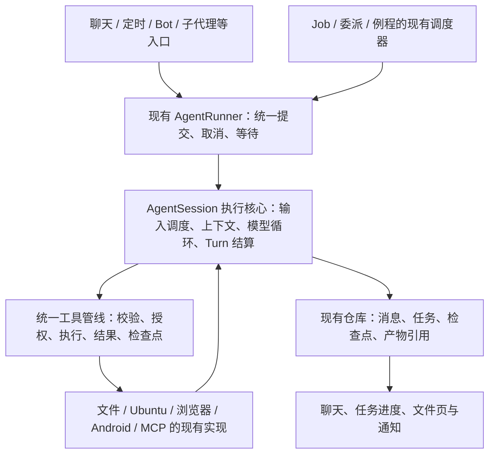

# Minis Agent 重整开发路线

> **历史路线。** M1–M5 的 Agent 执行基础仍在现役版本中；Bot 成员、派工、收件箱和 Bot 语音入口已于 Room v27 移除。本文中的 Bot 产品方向、阶段安排和验收结果只描述移除前的版本，不是当前功能或待办。

核对日期：2026-10-14。核对对象：`main` 当前未提交工作树，HEAD `3527ad8165f11c0f98d8a30f96098fc9280faa94`；切片工件保留各自冻结日期与验证范围。M1–M5 开发及本轮受控集中验收已完成，具体证据与设备未验范围见 [整体说明](M-SERIES-INTEGRATION.md)。

2026-10-12 历史补充：现有功能细解扩展为 35 项；Bot 曾参考 Grok Bot，本路线记录过本地持久协作成员的产品目标与分阶段落点。该方向现已停止。

同日语音切片：工作树已接通 Bot 详情的语音入口、真实身份与完整 Agent；当前会话忙时复用 STEER，补充要求和挂断保留任务。OpenBot 的持久成员、收件箱、统一领取和负责人设计，以及下一步对象恢复、持久接单和结果简报，见 [Bot 与语音融合方向](BOT-VOICE-INTEGRATION.md)。这不代表 M1–M5 架构迁移已完成。

开发主线：**按 M0 → M1 → M2 → M3 → M4 → M5 顺序推进 Minis 整体重整**。Bot、子代理、例程与语音随共同基础接入，不单独抢先扩展。当前 M1–M5 的执行所有者、任务闭环、工具事实、成果/备份及持久协作/语音已接入，17 组受控工作流、数据库迁移和 force-stop 恢复通过。最新实现与边界见 [整体说明](M-SERIES-INTEGRATION.md)；旧切片保留各自冻结证据，见 [任务持久化](AGENT-TASK-EXECUTION.md)。详情见 [执行核心与验收](AGENT-CORE-EXECUTION.md)。已有能力见 [源码盘点](../analysis/minis-agent-inventory.md)；长期边界以 [合同](../contracts/01-ARCHITECTURE.md) 和 [工程规范](../contracts/05-ENGINEERING.md) 为准。

## 1. 产品方向与交付标准

Minis 的方向是：**能在 Android 手机上持续完成实际任务、保留工作现场、验证结果并交付产物的通用 Agent。**

主流程：用户说明目标与资料 → Agent 理解约束、选择能力 → 连续观察与执行 → 验证结果、必要时修订 → 交付文件或可复核的操作结果。用户补充信息、暂停、重启与恢复都应发生在这条流程里。

优先支持三类完整工作：

| 工作类型 | 用户能得到什么 | 主要已有能力 |
|---|---|---|
| 开发与文件工作 | 修改工程、运行构建、定位错误、生成文档、整理并导出文件 | Ubuntu、Shell/Job、文件工具、工作区、技能 |
| 浏览器与信息工作 | 检索和读取资料、操作网页、整理来源、生成报告 | 浏览器、Provider、附件、历史、上下文 offload |
| Android 本机工作 | 操作应用、检查 APK、采集诊断、处理已授权的原生数据 | Android 工具、物理/虚拟屏、能力探测、结构化 Root 工具 |

Android 本机执行与手机资料是 Minis 的特色，三类工作共用执行主干。联系人、日历等按任务启用；桌宠与语音是交互入口，接入完整工具任务需经过同一核心。2026-10-12 工作树已接通语音对话与完整 Agent 回合，现已共享 AgentSession 执行核心；持久接单、唤醒对象恢复与真实音频体验仍待补齐，专用 PTC executor 等仍按真实调用需求评估。

完成标准由用户请求决定：文件任务有可打开、内容正确的产物；设备操作有执行后的观察证据；需要构建的改动有相应构建结果。普通问答可以直接结束；只有需要持续执行的目标才建立跨回合任务。不能要求用户先创建项目或填写任务表，才能开始做事。

### Bot 的产品定位：手机上的持久协作成员（已停止，仅存档）

Grok Bot 是用户最初的产品参考。其官方说明围绕持久成员、工作上下文、协作及技能/例程组织体验；账户下的 Bots 共享一台云端计算机，并有各自的工作屏幕。参考的是“持续负责并完成工作”的产品关系。[官方概览](https://docs.x.ai/grok-bot/overview)、[成员管理](https://docs.x.ai/grok-bot/bots)、[计算环境](https://docs.x.ai/grok-bot/computer-and-apps)（核对日期 2026-10-12）。

Minis 对应的执行环境是用户手机、Android 应用、Ubuntu 与本机文件。**本地表示任务协调、状态和工具执行在设备上，当前模型仍由 Provider 接入，并不自动等于离线推理。** Bot 是用户长期保留、具有明确职责的成员；子代理是某次工作的独立子任务。Bot 可以使用共同的执行能力，工作记录和资料归属仍须明确。

| 产品关系 | Minis 当前基础 | 需要完成的关系与落点 |
|---|---|---|
| 长期成员 | 持久名字/职责/默认模型、多个会话、成员页面 | M1 固定运行所有权；M2 任务由成员负责到底 |
| 长期工作上下文 | 会话历史、共享资料、全局记忆、角色剧情记忆 | M4 增加有真实归属的 Bot 工作上下文，区分用户偏好、成员经验、当前项目事实；不是复用虚构角色剧情记忆 |
| 本机工作现场 | Android 工具、Ubuntu、浏览器、物理/虚拟屏 | M3 能力/实际后端对齐；M4 把资料、现场和成员/任务关联，屏幕并发按租约验证 |
| 协作与成果 | 持久委派、inbox、自动负责人复盘 | M2 先修完成条件与恢复；M5 完善交接/结果呈现，负责人承担验收 |
| 技能与例程 | 全局技能、会话启用、可绑定 Bot 的定时任务 | M4 明确成员使用的技能/资料配置；M5 连贯展示例程与工作，不重复创建技能/调度系统 |
| 成果与进度入口 | 成员近期会话/工作、任务进度、文件预览 | M4 持久产物引用；M5 从成员/任务直接打开成果、接续和等待原因 |

上表的成员、委派与 inbox 落点**已停止开发**，不构成待办：Bot 运行时、成员页面和对应合同已从现役版本删除。表内保留的是移除前的产品参考记录。仍然生效的只有任务完成规则：负责人回合结束不自动完成根任务，完成须提交当前任务的真实证据，否则进入待处理状态。

多成员群聊、任务转交等组织化能力没有现役需求；将来若确实需要，先设计产品流程，不为模仿云端组织图提前新增 Chief、Team Runtime 或独立 Root 后端。

本地持续工作的验收需覆盖息屏、网络中断、前台服务、系统杀进程和重启。任务状态与文件可以持久，活跃工具和进程按实际条件恢复；设备关机期间不执行，重新上线后的处理需遵守已保存的用户授权和任务状态。云端计算机的存活保证不能直接写成手机上的承诺。

## 2. 四个参考项目，分别学什么

下列结论来自固定源码快照；链接即核对入口。参考的设计落实到 Minis 现有 Kotlin/Room/Android 架构。

| 参考 | 借鉴的具体设计 | Minis 的落点 |
|---|---|---|
| [Pi 核心工具](https://github.com/earendil-works/pi/blob/96abe9a5ad45005cae34ed1c52d42f71fc88bedc/packages/coding-agent/src/core/tools/index.ts) | 编码主干围绕 read、bash、edit、write；扩展工具有独立定义 | 稳定已有四工具主干，复用文件修改队列和结果 offload；扩展能力按任务发现 |
| [Codex 编排](https://github.com/openai/codex/blob/a07c8ebd57feedc4cf5dfe854c8e9101de54186b/codex-rs/core/src/tools/orchestrator.rs)、[权限说明](https://learn.chatgpt.com/docs/agent-approvals-security) | 集中安排授权、执行环境与受控重试；确认策略和执行权限分开 | 统一工具调用管线与实际后端事实，复用已给授权，执行失败要能说明原因和下一步 |
| [DeepSeek Harness 架构](https://github.com/deepseek-ai/deepseek-harness/blob/d743267388641bc76f17c45ce8b4c231aed1d32c/docs/architecture.zh.md)、[工具流水线](https://github.com/deepseek-ai/deepseek-harness/blob/d743267388641bc76f17c45ce8b4c231aed1d32c/docs/tool-execution-pipeline.zh.md) | 会话记录、实时事件与工具结果各有职责；调用到结算具有统一顺序 | 模型循环已迁入 AgentSession；继续复用 SessionEventHub、检查点、Room，收敛权威状态与 UI 投影 |
| [OpenCode Shell](https://github.com/anomalyco/opencode/blob/d21b0790a6c146815f28fea604e41e922f009590/packages/core/src/tool/plugin/shell.ts)、[文件读取](https://github.com/anomalyco/opencode/blob/d21b0790a6c146815f28fea604e41e922f009590/packages/core/src/tool/read-filesystem.ts) | 显式 cwd、后台任务、结构化完成结果、完整输出引用；文本预算与文件传输分开 | 固定会话工作目录与 Job 语义；任务、工程资料、交付物有可追溯关系；预算按用途设置 |

这些参考用于作设计判断。框架、语言和插件系统的整套迁移不在本轮路线内。源码移植若发生，按工程规范核对兼容性并在 `PROVENANCE.md` 维护法律来源。

## 3. 目标结构：一套执行核心，明确状态归属

“统一”指各入口使用同一任务与结果语义。Shell 进程、Android 操作、Bot 派工和定时器各自保留适合的平台生命周期。

| 概念 | 职责与完成含义 | 优先复用的位置 |
|---|---|---|
| Session | 对话与工作环境归属；可以包含多次工作 | Room session/message、ChatRepository、session workspace |
| Task | 用户目标、约束、验收条件及跨回合进度；达到验收条件才完成 | BotTaskEntity / BotTaskRepository；普通 Goal 接入其语义 |
| Run | 一次启动或接续尝试；记录入口、模型、执行身份与终态 | RunCheckpointStore、AgentRunner、现有运行记录 |
| Turn | 一次输入引发的模型与工具循环；完成表示本回合结算 | AgentTurnHandle、现有主循环与 ToolRound |
| Job / 委派 | Task 下的一项工作；结束后将证据交回负责人 | ShellJobs、JobRegistry、SubAgentJobRegistry、Bot 委派/收件箱 |
| Artifact | 输入、工作结果或交付物的持久引用；有来源与验证状态 | 现有文件/消息归属，补最小产物索引 |

这是职责词汇表，实施时不要求为每个名字新建类或数据表。

当前重要事实：Bot 已有持久根任务，并区分 PLANNING、EXECUTING、REVIEWING、REVISING、DELIVERING；普通明确 Goal 与任务计划已通过 M2 第一切片接入该根任务语义；临时 Todo、无 Goal 的软计划和 Deliverable 仍是进程状态。Room v24–v25 允许 `ownerBotId` 为空，并用唯一的 `goal_session_id` 关联当前普通目标，v23 旧 Bot 数据保持原值；不使用虚假 Bot 或平行任务框架。普通 ACTIVE 目标在同一循环按预算接续；完成记录实际验收证据。

## 4. 决定开发取舍的原则

### 持续工作与用户控制

- 在已授权目标内继续必要工作；等待 Job、工具失败或一次模型回复结束，不直接等于目标完成。
- 用户的新消息进入当前工作：补充、纠正、询问进度、暂停与替换目标分别处理。每个 session 的输入顺序、忙时排队与取消关系需要确定。
- 用已有任务阶段和终态表达执行、等待、需要用户、暂停、完成、失败与预算耗尽。未知副作用结果作为证据状态记录，不能自动重放。
- 暂停/取消的停止代次优先于迟到回执；完成回执不得重新激活已停止任务。复用 Bot 现有 stopGeneration 和条件更新方式。
- 预算、期限与回退来自用户设置或明确产品规则。恢复使用已保存的实际规则；配置耗尽给出真实状态，避免用一次重建上下文重置预算。
- Android 进程死亡后的“恢复”首先是还原现场、识别未结算动作、核实结果；自动唤醒还受授权和平台后台条件约束。

### 工具帮助 Agent 完成工作

核心文件/Shell 工具稳定提供；任务控制、等待/取消、提问及能力发现入口必须可达。Android、浏览器、技能和 MCP 扩展按需要披露，不能用工具数量硬上限藏掉完成任务所需的能力。

能力目录优先从 `ToolRegistry` 和现有 schema 生成，避免手写另一份 catalog。实现按需发现时，工具定义在调用批次内固定；发现的定义必须可用于后续调用，并遵循会话身份和授权。能力“可发现”、模型“能看见 schema”、调用“被允许”、后端“可执行”分别记录。

参数校验、调用方权限、执行身份、超时/取消、结果预算与结算放在有明确顺序的共享管线中。模型调用、CLI、MCP 共用既有实现，同时保留各自调用方限制。浏览器/记忆已接入注册表，旧分发已删除；其它领域入口继续沿既有实现收敛结果与回执。

上下文预算限制进入模型的内容；内存预算限制同时缓冲的数据；磁盘预算限制可写空间；平台限制说明对应条件。大文件传输使用流式路径，完整工具输出以文件引用保留。不能把文本预览大小直接当作文件复制或安装包上限。

### 授权与后端事实一致

| 维度 | 实施要求 |
|---|---|
| 用户确认 | 已有授权持续有效；确需新授权时说明具体动作和原因。`ApprovalSeam.never` 当前表示拒绝需要审批的动作，不代表自动允许所有动作 |
| 会话/例程策略 | workspace-write 文件 gate、例程 READ_ONLY/FULL 等有各自作用域；不将文件 gate 宣称为完整 OS Shell 沙箱 |
| 调用身份 | 本地、MCP、Bot/子任务各自的可见性和权限由真实 caller 决定 |
| Android 能力 | 授权状态、服务自检、实际后端、设备条件与失败原因一起返回 |
| 执行身份 | Guest App UID、Root 与 Shizuku 分别处理，保留合同规定的受控入口 |

诊断能力报告已与实际后端对齐：`privilegedAvailable` 只看 Root 授权，`PrivilegedCommandRunner` 实际走 DirectRootRunner，普通 App 回退及 Shizuku 自身连接状态分别报告。等价 Shizuku 后端、输出/进程清理和权限撤销仍按实际动作核对，Root/Shizuku/OEM 行为需要真机证据，不能据能力目录宣称已验收。

## 5. 开发里程碑与依赖

依赖顺序：**M0 → M1 → M2 → M3 → M4 → M5**。2026-10-14 已接入 M1–M5 主要开发链路，现役行为见 [整体接线](M-SERIES-INTEGRATION.md)。以下保留设计和验收范围；当前按用户要求先整体开发，再集中验收，不重复从 M1 开工或逐片跑同一组测试。

### M0：把完整工作流变成基线

交付：固定输入、环境说明、可重复运行入口和机器可读结果。对现有三类工作记录当前表现，不为未运行的场景填写成功率。

工作项：

1. 选定第 7 节端到端场景，记录输入、期望结果、所需权限与可核验产物。
2. 从现有 Debug/instrumentation 入口运行；状态与权限验证使用受控 Provider，真实模型能力评估单独运行。
3. 保存失败类型、用户介入次数、模型/工具调用数、耗时、上下文成本、重复副作用和结果引用。
4. 区分宿主构建、模拟器、真实 Root/OEM 设备；Release 资源链接基线问题单独追踪，不能用 Debug 代替 Release。

主要入口：现有 `src/android/app/src/androidTest/`、Debug 调试入口、`AgentRunner` 与现有脚本。

验收：另一位开发者按记录可重跑场景并校验工件；缺少真机的项明确待验。已有大 APK/跨目录工件可作为其中一个工具场景，不能代替 Agent 任务基线。

### M1：执行核心独立于聊天页面

交付：普通聊天与后台入口消费同一执行所有权和 Turn 结果；页面打开、退出与重建不会创建第二个模型循环。

开发切片：

1. 先核对所有提交、等待、取消、重试、重跑与删除会话调用方；固定 session 排队和 per-turn 句柄语义。
2. 经 `AgentRunner` 迁出运行生命周期与非 UI 执行状态，保留现有 Provider、消息仓库、工具调度和事件实现。
3. 再迁上下文组装和模型循环；ChatViewModel 保留输入、显示与 UI 投影。每次迁移只有一个现役循环。
4. 产品入口解除对 `debug/HeadlessChatRunner` 的依赖；Debug 成为同一核心的适配入口。

主要入口（相对 `src/android/app/src/main/java/com/openminis/app/`）：`agent/AgentRunner.kt`、`agent/AgentSessionStore.kt`、`agent/AgentSession.kt`、`agent/AgentTurnHandle.kt`、`agent/AgentExecution.kt`、`agent/AgentConversation.kt`、`agent/AgentLoop.kt`、`agent/AgentCompaction.kt`、`agent/ToolRound.kt`、`agent/TurnStream.kt`；页面投影为 `ui/chat/ChatViewModel.kt`、`ui/chat/ChatViewModelStore.kt`，远程只读投影为 `remote/SessionSnapshotReader.kt`。2026-10-12 工作树已迁出全部执行实现和非 UI 状态；ChatViewModel 只保留页面订阅/输入适配。37 场景连续 10 轮及 17 项共享入口回归通过，证据见 [核心说明](AGENT-CORE-EXECUTION.md)。

验收：聊天发起构建 → 切换页面 → 后台任务完成 → 回到聊天，只有一次执行与一个终态；忙时提交、进度询问、取消、删除会话、迟到回调都有完整流程验证。`isStreaming` 只表达 UI 活动，不承担任务成功判断。

### M2：普通任务也能持久推进、恢复与验收

交付：普通持续目标和 Bot 根任务共享完成、暂停、接续与验收语义；重启后能找回目标、约束和已完成工作。

开发切片：

1. 梳理 BotTask 的创建、owner、预算、revision、收件箱与回执调用链，设计普通 session owner 的最小兼容迁移。
2. 将普通 Goal 接到持久根任务；任务必需的计划/进度持久化，保留临时 Todo 的轻量用法。无需持久的信息不写数据库。
3. 明确 Task、Run、Turn、Job 关联，并将检查点中的未结算动作纳入恢复决策；复用现有记录，不新增另一套无限事件日志。
4. 在 Run 结束或子工作回执后执行目标验收；未达成时按保存的规则继续、修订或等待。用户暂停/取消后不接续。
5. 完成条件至少关联实际证据与可复核结果；不能仅凭 `goal_complete` 调用或自然语言“完成了”升级整个目标终态。

Bot 既有自动复盘同样纳入本阶段：已将 `BotWakePolicy.transition` 改为要求真实验收，已接入来源事务去重、成员未结算拒绝完成、实际负责人/成员级联取消和回执幂等；验证“还需用户决定”“没有实际交付”和“确实达到验收条件”能分别结算。

主要入口：`data/db/BotTaskEntity.kt`、`BotTaskDao.kt`、`data/repository/BotTaskRepository.kt`、`tools/AgentStateStore.kt`、`GoalTools.kt`、`BotDelegationCoordinator.kt`、`agent/RunCheckpointStore.kt`、`tools/ToolCheckpointStore.kt`。

验收：修改工程 → 中断进程 → 重启 → 还原任务 → 核实已有文件与工具结果 → 继续验证交付。未知结果的安装/外部写入先核实；暂停后迟到回执不能唤醒；旧 Bot 任务数据和预算能正确迁移。

### M3：统一工具管线与能力目录

交付：同一动作各入口返回一致的成功/失败语义；模型能按任务发现可用能力，授权后正常执行，无需反复猜工具和后端。

开发切片：

1. 执行意图、注册工具时限、取消传播与结果分类已接入共享 ToolExecutor，权限拒绝在执行体之前发生；Room 精确回执由 AgentSession 持久化结算。后续补跨领域和各传输入口的一致性，不再从 ViewModel 迁出这些执行实现。
2. 收敛 canonical 名、alias、schema、CLI 分发与旧工具路径。MCP caller、local-only、READ_ONLY 等边界在共享路径中仍有效。
3. 按注册表生成能力摘要，补最小按需发现路径；保留批次内定义与任务控制入口。先做既有 catalog 的复用，再判断是否需要新工具。
4. 对齐 Android 探测与实际后端，明确权限撤销、Root 不可用、Shizuku 断开、虚拟屏切换应用时的恢复语义。
5. 统一结构化结果和完整输出引用；区分拒绝、超时、取消、执行失败、成功但观察失败以及结果未知。重试前检查副作用证据。

子代理已收敛到现役角色/队列 runtime：总开关关闭同时隐藏 schema 和拒绝委派，旧同步 SubagentTool 已删除，现役与旧 child source 都按子会话处理。共享参数校验、注册工具时限、极简模式任务控制和诊断后端事实已接入；browser/memory 与浏览器 CLI 已共享校验、权限和时限；模型意图已迁入共用执行器并保留 Room 精确结算；按会话/令牌范围的工具发现已接入，目录不改变本轮定义；结构化结果与未知回执保留已接入，四类领域 CLI 的权限撤销已核对；Ralph 精确取消/清理、独立父会话并行及实际单轮设置已收敛；日历/联系人目标选择、提醒、字段清空和模型/CLI 实际 Provider 交叉读写已通过模拟器端到端核对；设备后端仍按真机证据验收，见 [工具执行整理](AGENT-TOOLS-EXECUTION.md)。

主要入口：`tools/AgentTools.kt`、`tools/runtime/ToolRegistry.kt`（ToolExecutor）、`agent/ToolRound.kt`、`agent/AgentLoop.kt`、`agent/AgentPersistence.kt`、`runtime/guest/GuestCommandBridge.kt` 相关分发、`tools/ToolExecutionResult.kt`、`tools/ApprovalSeam.kt`、`tools/android/AndroidCapabilityResolver.kt`、`tools/android/PrivilegedCommandRunner.kt`、现有浏览器/MCP 实现。

验收：模型工具与 CLI 完成相同授权动作，结果一致；MCP 请求 local-only Root 动作在执行前拒绝；只读例程、越界路径、撤销授权均不能产生写副作用。真实设备上核对 Root/Shizuku/虚拟屏条件，不以模拟器报告替代。

### M4：工作现场、上下文与交付可长期使用

存储统计、持久成果引用与会话分类清理已接入：原生包统计覆盖应用数据，Root/目录计量失败保持未知，会话别名目录不重复计数；成果复用已完成任务证据，核验当前文件并打开实际来源目录，清除 Goal 不丢历史引用。分类清理先关闭对应 owner 并等待收尾，实际 MainActivity 默认浏览器清理与保留成果打开已核对。上下文与资源交付继续推进，见 [工作现场与交付](AGENT-WORKSPACE-DELIVERY.md)。

交付：用户能找到任务使用的资料、生成的成果、验证证据和继续入口；Agent 压缩上下文后仍知道目标与现场。

开发切片：

1. 保持每 session workspace，明确关联工程目录/外部资料的方式。优先复用 session 元数据和已授权挂载；需要跨会话共享工程时明确共享范围与并发修改规则。
2. 为产物补持久引用：来源 task/session、路径或内容 URI、类型、验证证据与交付状态。文件已有归属可复用，不逐条复制所有目录文件进数据库。
3. 上下文按稳定指令、当前目标、进度/证据、相关历史与资源引用组织。压缩保留约束、未结算动作、下一步及产物引用；恢复时核验文件仍存在。
4. 技能按目录披露与需要读取；记忆区分用户明确偏好与任务事实、保留来源，复用现有检索与注入预算。先测检索效果再判断是否引入向量基础设施。
5. 文件页区分输入、工作成果、工具输出、可重建缓存与 runtime。补齐计量范围，支持可预览的分类清理；删除与历史引用、备份恢复、外部目录授权联动。

Bot 工作上下文在这里与资料/技能一起设计：让成员能找到自己的职责、近期工作摘要、关联资料与成果，并以明确共享范围交接。沿用现有 Bot ID、文件归属、Memory/Skill 仓库，确认需要持久保存的字段后再实施最小变更。

主要入口：`runtime/ubuntu/UbuntuPaths.kt`、`runtime/files/WorkspaceFileClient.kt`、现有 session/message 元数据、`data/ContextOffload.kt`、`agent/ContextOffloader.kt`、`agent/AgentContextCompactor.kt`、Skill/MemoryRepository、`ui/settings/FilesHubScreen.kt`、DocumentsProvider 与备份实现。

验收：资料进入会话 → 工作与压缩 → 生成产物 → 预览/导出 → 重启后打开 → 清理缓存后保留成果与有效引用。清理预览与实际释放空间能核对；只读外部资料不被改写。截图中的 5.78 GB 需按真实内容计量后分类，不能直接归为垃圾。

### M5：协作、定时与交互都服务同一任务

交付：用户能看清任务正在做什么、等什么、为何停止和结果在哪里；子代理/例程使用同一核心和终态解释。

开发切片：

1. 将子代理、Bot、Ralph 和例程关联到已有任务/运行记录；保持各自调度器，先统一结果、证据交接、取消与去重。
2. 子工作完成进入负责人审查；结果通知有任务归属、只投递一次，并尊重停止状态。先用完整场景证明缺口再修改通知逻辑。
3. Ralph 上下文轮换保存同一目标/预算/交接；例程继续采用现有 JSON 与权限档，不借本轮重整迁移 ScheduledTask 到 Room。
4. 聊天展示执行阶段、等待原因、可用的暂停/恢复和产物入口，文件页采用 M4 数据。保留熟悉的聊天入口，技术后端详情放诊断视图。
5. 语音任务通过同一核心提交；桌宠是否提供工具任务由明确产品入口决定。当前语音对话已接通，后续验证原生音频全双工与手机端真实体验；专用 PTC 单独评估调用需求。

主要入口：`agent/subagents/`、`tools/runtime/ToolRegistry.kt`、`BotDelegationCoordinator.kt`、`RalphTool.kt`、`scheduled/ScheduledAgentRunner.kt`、现有聊天/语音/通知 UI。

验收：用户任务 → 一次委派 → 负责人验证 → 修订或交付；取消之后不再派发/唤醒；重复回执只展示一次；只读例程与普通聊天保持各自策略。此前错误选模型、多次派发取消造成的通知不作为工具缺陷证据。

## 6. 首批开发切片

按依赖逐个开发、验收和合入，每个切片保留能运行的产品：

| 顺序 | 切片 | 审查重点 |
|---|---|---|
| 0 | 任务基线场景与结果工件 | 能从真实入口重跑；基线未测值保持空缺 |
| 1 | AgentRunner 的提交/等待/取消与 per-turn 所有权 | 所有调用方一致；页面重建和迟到回调不改变执行身份 |
| 2 | 执行生命周期迁出 ViewModel | 仍只有一个模型循环；前台服务、删除会话、异常清理一致 |
| 3 | 上下文与模型循环迁出，收敛 Headless 适配 | 普通聊天、Bot 和例程走同一核心；Provider 行为保持 |
| 4 | 普通 Task 归属与 BotTask 兼容迁移 | 无虚假 Bot；现存任务、停止代次、预算不丢失 |
| 5 | Goal 接续、检查点恢复与验收 | 回合结束不误报目标完成；未知副作用不重放 |
| 6 | 工具执行管线收敛 | 拒绝发生在执行前；各入口边界和终态一致 |
| 7 | 能力目录、按需发现与后端事实 | 工具调用可达；探测与真实路线一致；删除被替代死路径 |

上表保留最初切片与审查范围。当前切片 0–3 的受控基线和执行核心迁移、切片 4 的任务兼容迁移均已落地；切片 5 已接入接续、证据验收、完整未知文件写入独立核验及检查点损坏时的失败关闭，非文件领域恢复仍待补；切片 6–7 已有共享执行意图、结果分类、能力目录和后端报告，跨入口一致性及真机验收继续补齐。M4 已接入持久成果引用与分类清理，完整交付体验仍待验收。涉及安全合同或数据库边界变更时，同步更新相应合同与已确认缺口。

这里的“切片”是代码审查范围，当前实现仍在未提交工作树。M1–M5 开发已完成并集中保存整体验收证据；后续只补验明确的真实环境缺口或新改动，不重复开启旧切片。

## 7. 端到端验收与工件

只新增端到端验证，遵循本仓库用户要求，不在编码后补单元测试。每个复杂流程先记录失败方式，再实现并从真实产品入口验证。

| 场景 | 关键失败方式 | 验收证据 |
|---|---|---|
| 编码构建与交付 | 错 cwd、重复提交、输出被截断后误判成功、构建失败仍交付成功 | 最终 diff、构建 exit code、完整日志引用、产物校验 |
| 页面离开与用户打断 | 页面重建产生第二次执行、新消息丢失、取消后继续写、迟到回调覆盖终态 | task/run/turn ID、调用次数、状态顺序、最终文件 |
| 进程死亡与恢复 | 目标/预算丢失、已完成写入重放、未知结果误当失败、暂停被唤醒 | 重启前后记录、文件哈希、外部动作计数、恢复决策 |
| 浏览器资料与报告 | 资料与来源丢失、压缩后忘记约束、下载完成但产物不可打开 | 来源清单、报告内容、下载文件、预览截图 |
| Android 应用工作 | 探测虚报、服务撤销、应用切换后观察过时、执行成功后观察失败引发重复动作 | 设备信息、实际 backend、前后观察、操作次数、日志 |
| 跨目录文件与空间管理 | 大文件读入内存、跨域移动失败丢源文件、只读写入、删除历史引用成果 | 哈希/字节数、失败后的源文件、授权快照、清理账本 |
| 委派与定时 | 同一结果重复投递、负责人提前完成、取消后唤醒、例程越权、跨 session 混淆 | 主任务与子工作关联、回执去重、终态、拒绝且无副作用 |
| 上下文与模型回退 | 工具调用/结果失配、压缩遗漏约束、回退重跑副作用、配置泄漏 | 模型配置摘要、消息配对、目标约束、重复动作计数 |

确定性流程使用受控 Provider，但文件、进程、数据库、重启与 Android 操作走真实实现；真实模型评估固定输入、模型配置、技能和权限，独立统计。真实 Root/OEM、SELinux、Shizuku、VPN 与生命周期分别记设备证据。

每次运行产出 JSON 报告，至少记录：基线/工作树标识、场景版本、环境与设备、模型配置摘要、task/run/turn 关联、预期与实际终态、工具调用/用户介入/重复动作次数、产物路径与 SHA-256、日志与截图路径、未验证项。认证信息不进入工件。可用现有 `.local/test-runs/<run-id>/` 保存本地证据，并在审查描述中链接。

质量门槛：

- 相关确定性场景全部通过；拒绝/越界/取消场景确认没有相应副作用。
- 竞争和恢复验收检查精确身份、实际副作用和停止后唤醒；通过后不因固定轮数重复。仅新修改、失败或明确未解竞态才补跑受影响场景，保存每次实际工件。
- 固定真实模型任务集至少覆盖三类工作，基线与候选使用相同配置。记录成功率、用户介入、耗时和成本；以完整交付为成功标准，失败不能靠改输入从统计中消失。
- 首轮体验改进目标：同一任务集的非必要用户介入次数较基线减少至少 50%，完整交付成功率不下降。这是待验证目标，当前没有测量结果。
- 构建/Lint 按改动范围验证；Release/R8/JNI 改动必须完成 Release 路径。设备未验项不能写“已通过”。

## 8. 当前状态与下一步

| 内容 | 当前状态 |
|---|---|
| M1 核心 | 唯一执行所有者/页面投影保留；队列与精确请求取消收尾已接线 |
| M2 闭环 | 自动文件/Job/子代理终态、真实用户观察、legacy 原生核验与恢复复核已接线 |
| M3 工具 | 目录/权限/执行管线及领域/CLI/后台 UNKNOWN 事实已接线；真机后端仍需设备验收 |
| M4 现场 | SAF、核验交付、明确共享、成员背景/共享引用、Task/sidecar 备份已接线 |
| M5 协作 | 消息表持久接受/领取/恢复、任务绑定回执、例程接受信号、Ralph 交接及语音对象/任务 UI 已接线 |
| 整体构建/验收 | 17 组端到端工作流、迁移/force-stop 恢复、Debug/AndroidTest、Release Kotlin/R8 与 Debug/Release Lint 通过 |
| 真实模型/Root/OEM/生产签名 | 需要真实环境证据；模拟器不替代 |

最新实现和具体待验行为统一见 [整体接线](M-SERIES-INTEGRATION.md)。各切片页面和旧 `.local/test-runs/` 只证明其冻结源码/APK 与场景，不承担当前整体状态。已通过检查不机械重复，失败或新修改才复核相关范围。
